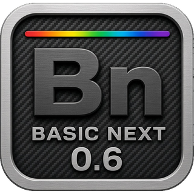

# Basic Next

<p align="center">
  
</p>

[](https://github.com/cquintella/BasicNext/actions/workflows/ci.yml)
[](https://github.com/cquintella/BasicNext/releases/latest)
[](LICENSE.md)
[](http://basicnext.org)

An object-oriented, general-purpose programming language designed to reduce
cognitive load and turn ideas into clear, cross-platform software.

Official website: [http://basicnext.org](http://basicnext.org)

Basic Next combines BASIC-inspired readability, explicit types, and host
capabilities without prescribing a framework or architecture. Clear,
predictable code should help programmers sustain attention and enter a state
of flow while reading and writing software.

**Basic Next** (two words) is the language; **BasicNext** is the repository
and package identifier. It is not
[NextBASIC](https://wiki.specnext.dev/NextBASIC), the extended Sinclair BASIC
of the [ZX Spectrum Next](https://www.specnext.com/).

## Hello World

```basic
FUNCTION Start() AS VOID
    PRINT "Welcome to Basic Next"
    LET counter AS INTEGER = 0

    WHILE counter < 10
        PRINT "Basic Next", counter
        counter += 1
    END WHILE
END FUNCTION
```

- `FUNCTION Start()`: every program begins here. `Start` returns `VOID` or
  `INTEGER`; an `INTEGER` becomes the process exit status.
- `PRINT "Basic Next", counter`: prints its values separated by a space.
- `LET counter AS INTEGER = 0`: a variable states its type and starts with a
  value.
- `counter += 1`: integer arithmetic is checked; overflow stops the program
  with a diagnostic instead of wrapping.
- `END WHILE`, `END FUNCTION`: each block closes with a named `END`.

## Design goals

- Readability before abbreviation.
- Low cognitive load, flow by clarity, and explicit contracts.
- KISS: complexity must solve a concrete problem.
- Explicit types: every variable states its type; a constant may take it from
  its literal.
- Clean Code and Clean Architecture should be natural, never mandatory.
- Cross-platform software through `HOST` capabilities rather than vendor APIs.

[PHILOSOPHY.md](PHILOSOPHY.md) holds the mission, vision, and complete set of
design principles.

## Toolchain

Two executables share one frontend, one diagnostic format, and one exit-status
model:

- `bni` interprets and hosts the tools: `run` (with optional `--trace-events` and `--profile`), `eval`, `check`, `lex`, `lsp`
  (language server), and `dap` (debugger).
- `bnc` compiles to a native executable through LLVM:
  `bnc hello.bn` (or `bnc hello.bn -o hello`). `bnc -g` adds debug information
  (DWARF; a PDB on Windows).

The default executable is portable (`--opt 2`, generic CPU). For an
executable optimized for the machine that builds it, run
`bnc --opt 3 --cpu native hello.bn`, or the wrapper that also strips the
symbols:

```sh
scripts/build-native.sh hello.bn          # Linux, macOS
.\scripts\build-native.ps1 hello.bn       # Windows
```

It runs on machines with the same CPU features; no option changes a
program's results (no fast-math).

A program needs no project file: `bni hello.bn` or `bnc hello.bn` is enough; `bnr`
opens the interactive REPL. The manuals are [`bni(1)`](man/bni.1),
[`bnc(1)`](man/bnc.1) and [`bnr(1)`](man/bnr.1).

## Installation

**Linux / macOS**

```shell
curl -fsSL https://raw.githubusercontent.com/cquintella/BasicNext/main/scripts/install.sh | bash
```

The script asks for a prefix (`$HOME/basicnext`, `/opt/basicnext`,
`/usr/local`, or another path), then installs the latest release's `bni`,
`bnc` and `bnr` (checksum-verified; for a release that ships no `bnr` binary,
such as 0.6.9, it builds the REPL from that release's source when `cargo` is
installed), the standard-library modules, the diagnostics
catalog, and the man pages. It uses `sudo` only when the prefix is not
writable, and builds from source with `cargo` when the release has no binary
for your platform. Skip the menu with `--prefix DIR`; pin a release with
`BN_VERSION=v0.6.9`. The install writes `$HOME/.basicnext/uninstall.sh`.

**Windows (PowerShell)**

```powershell
irm https://raw.githubusercontent.com/cquintella/BasicNext/main/scripts/install.ps1 | iex
```

The script installs to `%LOCALAPPDATA%\Programs\BasicNext` without administrator
rights, or to `$env:BN_PREFIX`. It downloads the latest release's `bni.exe`,
`bnc.exe`, `bnr.exe` and `bn_rt.lib` (checksum-verified against `SHA256SUMS`;
without a `bnr.exe` asset, as in 0.6.9, it builds the REPL from source when
`cargo` is installed), the
standard-library modules, and the diagnostics catalog, updates the user `PATH`,
and writes `%USERPROFILE%\.basicnext\uninstall.ps1`. Pin a release with
`$env:BN_VERSION = 'v0.6.9'`.

Or from a local repository checkout:

```powershell
powershell -ExecutionPolicy Bypass -File scripts\install.ps1
```

`bnc` needs `clang` on `PATH` (CI tests LLVM 22); `bni` needs nothing else.

**Prebuilt binaries** for Linux, macOS, and Windows are on
[GitHub Releases](https://github.com/cquintella/BasicNext/releases/latest);
[`binaries/README.md`](binaries/README.md) lists the asset names and
checksums.

**From source** (Rust 1.98, pinned in `rust-toolchain.toml`):

```shell
cargo install --path crates/bni
cargo install --path crates/bnc
```

`cargo install` installs only the executables; use the install script to also
get the standard-library modules and man pages on disk.

## Examples

From a checkout, `cargo run -p bni -- run <file>` uses this tree's toolchain.

| Program | Focus |
| --- | --- |
| [`examples/hello.bn`](examples/hello.bn) | Minimal `Start` |
| [`examples/language-tour.bn`](examples/language-tour.bn) | Broad language surface |
| [`examples/conversions.bn`](examples/conversions.bn) | Every `AS` conversion |
| [`examples/filesystem_tour.bn`](examples/filesystem_tour.bn) | `HOST.FileSystem` |
| [`examples/socket.bn`](examples/socket.bn) | `HOST.Net` |
| [`examples/exec-demo.bn`](examples/exec-demo.bn) | `HOST.Exec` |
| [`examples/bnlog_tour.bn`](examples/bnlog_tour.bn) | `BNLog` console and file transports |
| [`examples/bnstring_tour.bn`](examples/bnstring_tour.bn) | `BNString` |
| [`examples/bndata_tour.bn`](examples/bndata_tour.bn) | `BNData` and CSV |
| [`examples/sqlite.bn`](examples/sqlite.bn) | `BNSqlite` database operations and transactions |
| [`examples/ffi.bn`](examples/ffi.bn) | `BNFfi` C foreign function calls |
| [`examples/parallel-examples.md`](examples/parallel-examples.md) | `BNDispatch`, including a parallel computation of pi |

## Release notes

### 0.6.12 (carries 0.6.11)

- **`HOST.FileSystem` directories**: `GetCurrentDirectory`, `SetCurrentDirectory`, `CreateDirectory`, `RemoveDirectory`, `IsDirectory`, private `OpenNew`, `Copy` and `Move`, with codes `IS_NOT_DIRECTORY` (10), `DIRECTORY_NOT_EMPTY` (11) and `ALREADY_EXISTS` (12). No symbolic link is followed, an existing entry is never changed, new entries are owner-only on Unix, and every path obeys the execution policy.
- **`BNCrypto.Key`** with operating-system random keys and nonces, wiped on release.
- **`BNCompress`**: DEFLATE, Gzip and ZIP archives, with `ZIP_SLIP` and size limits and the filesystem policy.
- **`BNMath`**: compensated `Sum`, `Product`, `Dot` and Student's t distribution.
- **Numeric literals**: out-of-range literals are `TYPE_MISMATCH` in every destination; an integer constant with no destination is `INT32`.
- Details: `docs/releases/0.6.11.md` and `docs/releases/0.6.12.md` in the documentation tree.

### 0.6.10

- **Numerics & Descriptive Statistics (`BNMath`, `BNData`)**:
  - Stable, non-allocating vector reductions: compensated (Neumaier) `MEAN` and corrected two-pass `VARIANCE` and `STDEV` passing NIST StRD benchmarks (NumAcc1–4).
  - New statistical functions: R type 7 `BNMath.Quantile`, sample and population `Skewness` / `Kurtosis`, sample `Covariance` and Pearson `Correlation`, exact `Gcd` and `Lcm` on `INT64`.
  - Missing value operations in `BNData`: `DataFrame.CountNA`, `DropNA`, and `FillNA`.
- **Language & Type Semantics**:
  - Block scope strictly enforced for loop bodies (`FOR`, `FOR EACH`, `REPEAT`), ending lifetime at loop termination.
  - Swift-like alternative narrowing: variables narrow strictly via `IS`, with assignment properly resetting narrowed types.
  - Verified operator precedence for power (`-2 ** 2` is `-4`), compound assignment places evaluated exactly once (`t = t op b`), and strict non-coercion of inexact integer literals to float.

### 0.6.9

- **Interactive REPL (`bnr`) stabilization**: dedicated 64MB execution thread matching interpreter stack budget, resolving stack exhaustion on recursion; entry point encapsulation via `__session_entry` synthesis, eliminating recursion and symbol collision with user-defined `FUNCTION Start()`; variable persistence across REPL turns for ARC-managed types (`STRING`, `OBJECT`, `VECTOR`); clean transparent panic propagation on thread join (`resume_unwind`); line-by-line injection test suite passing all 16 canonical examples with full `bni` parity.
- **Statement-form `INPUT target` with silent `EOF` fallback**: direct support for pure `STRING` targets in `INPUT target` statements with silent `EOF` fallback to empty string `""` across both `bni` and native LLVM runtime (`bn_llvm` / `bn_rt` via `bn_input_str`), while keeping the expression form `INPUT()` strictly typed as `STRING OR EOF`.
- **Toolchain and Quality Gates**: full compliance with all 34 quality gates (`cargo test --test gates`), zero text literals in production code, catalog key integrity.

### 0.6.8

- **Runtime instrumentation and event tracing**: new event-driven layer (`bn_runtime_instrumentation`) embedded in `bn_interp` with zero overhead when inactive; `--trace-events <file>` streams execution history in structured NDJSON format.
- **Function execution profiler**: `--profile table|json` collects execution statistics (call counts, self-time, cumulative time) with high-precision metrics.
- **DAP modernization**: `bn_dap` decoupled from legacy hooks through `DebuggerConsumer`, preserving 100% protocol parity.
- **Modular standard libraries extraction**: domain libraries (`BNWeb`, `BNLog`, `BNSqlite`, `BNData`, `BNJson`, `BNDispatch`, `BNCrypto`, `BNString`, `BNMath`) relocated strictly under `libraries/` and `bn_stdlib`, decoupling the core compiler and runtime.
- **Native Host parity**: closed gaps in `HOST.Random` and host execution policies across compiler and interpreter.

### 0.6.7

- **Standard C Foreign Function Interface (`BNFfi`)**: C foreign function calls through standard module `BNFfi` with exact cross-backend parity on `bni` and `bnc`, isolated `unsafe` in `bn_rt::ffi`, zero leak lifecycle, and 34 verified ABI symbols.

### 0.6.6

- **Consolidated test system**: 7 integration targets consolidated from 32 root binaries, full baseline migration ledger with zero test loss, Clean Code domain partitioning, and stale-binary guards.

### 0.6.5

- **Typed LLVM and one class model.** `bnc` lowers through a typed in-memory LLVM module. Classes, upcasts, and interface calls use one model on `bni` and `bnc`.
- **Shared domain cores.** `BNSqlite` and `BNJson` run from `bn_core_sqlite` and `bn_core_json` on both backends. `BNWeb` links only when the program imports it, and an HTTP client with a logger writes one access record per request.
- **`HOST.Env` and `bnc --cpu`.** Environment lookup is a host capability. `--cpu native` may use measured CPU kernels; the default artifact stays portable.
- **WebAssembly withdrawn.** `bnc` compiles native executables only.
- **Messages live in the catalog.** Diagnostics and runtime text are catalog entries. `Address.ToString` keeps its string, and `FOR EACH` over an owned vector no longer frees the vector at the loop edge.

### 0.6.4

- **Implicit interpreter execution**: running `bni <file.bn>` directly defaults to `bni run`, preserving program arguments after `--`.
- **One-line Windows PowerShell installation**: single-line installation via `irm https://raw.githubusercontent.com/cquintella/BasicNext/main/scripts/install.ps1 | iex` with automatic GitHub API rate-limit fallback and support for `$env:BN_PREFIX`.
- **BNSqlite library driver**: complete SQLite 3 client integration with support for `:memory:` and file databases, atomic transactions (`Begin`, `Commit`, `Rollback`), parameterized execution, and row mapping into `DataFrame`.
- **Concurrency & Mutex Poisoning Resilience**: asynchronous DNS resolver and connection registries in `bn_rt` recover gracefully from thread panics without crashing the main process or runtime shutdown.
- **Memory Safety & FFI Cast Validation**: eliminated negative integer casts in `sqlite3_column_count`, preventing potential OOM crashes.
- **RAII Resource Management**: intermediate LLVM IR (`.ll`) and object (`.o`) files are guaranteed to be cleaned up deterministically upon any early toolchain failure.
- **CLI Diagnostics Normalization**: fixed help messages in `bnc` and strengthened LLVM backend lowering against unexpected scalar and vector types.

## Documentation

- [Official Website](http://basicnext.org): releases, documentation, and news.
- [Language specification 0.6](language/0.6/0.6.md), with its
  [grammar](language/0.6/0.6.ebnf) and [keywords](language/0.6/keywords.md):
  the normative contract.
- [The Basic Next book](https://github.com/cquintella/basicnext-book): the
  tutorial.
- [Runtime ABI contract](language/0.6/value-memory-abi.md).
- Edit `.bn` files with the [VS Code extension](https://github.com/cquintella/basicnext-vscode).
  Download the latest `.vsix` from that repository's releases and install it with
  `code --install-extension basicnext-*.vsix`.
  Also available: [Vim / Neovim plugin](https://github.com/cquintella/basicnext-vim)
  and [Jupyter kernel](https://github.com/cquintella/basicnext-jupyter).

## Contributing

Read [CONTRIBUTING.md](CONTRIBUTING.md). A language change starts as a
proposal and changes the specification, with examples, before the code.

## Authors & Credits

- **Carlos Quintella** ([@cquintella](https://github.com/cquintella)) — Creator and BDFL.
- **Google Gemini** ([@google](https://github.com/google)) — Programming Co-author and Agentic Pair Programmer.

## License

[MPL 2.0](LICENSE.md).
